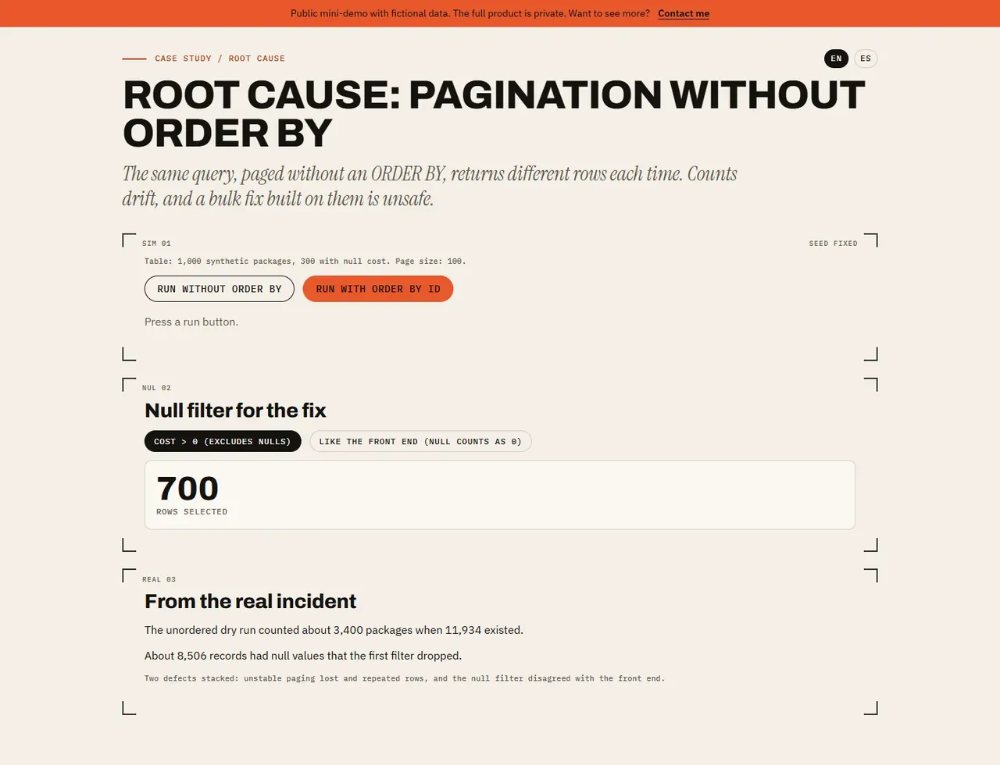

# Root cause — pagination without ORDER BY

## Screenshots



> Public mini-demo with fictional data. The full product is private; access on request: carrerabernal@gmail.com

## Live demo

https://carrerable.github.io/pagination-bug-demo/

## What it demonstrates

- A paged query without `ORDER BY` can return different rows between pages, so a full scan loses some rows and repeats others.
- With `ORDER BY id` the scan is complete and stable.
- A null-handling filter that disagrees with the front end selects a different set of rows.
- The explanation uses the figures of the real incident (about 3,400 counted vs 11,934 existing; about 8,506 null records), clearly labelled as such.

## What is fictional and what is real

The 1,000 packages, the random generator and the "database" are synthetic and deterministic. Only the two incident figures in the explanation come from a real event, and they are labelled. The code is written from scratch.

## Run locally

```bash
npm ci && npm run dev
```

Add `?lang=es` for Spanish.

## Tests

```bash
npm test
```

## How it was built

Code written with Claude Code under my specs and code review; I designed the behavior, wrote the acceptance tests and verified the result.

## Case study

https://carrerable.github.io/en/projects/pagination-root-cause/

## License

MIT
